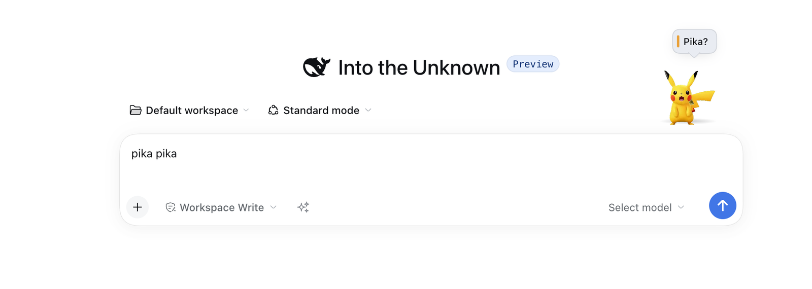
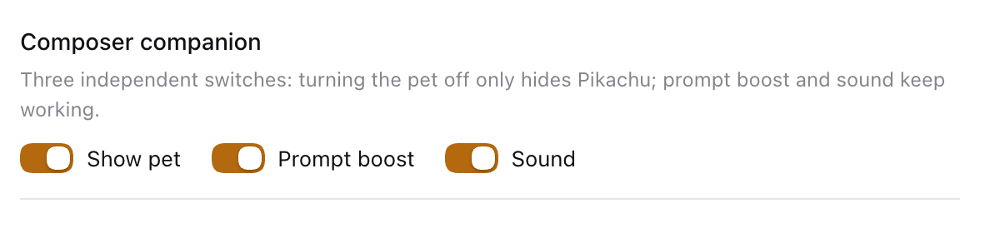
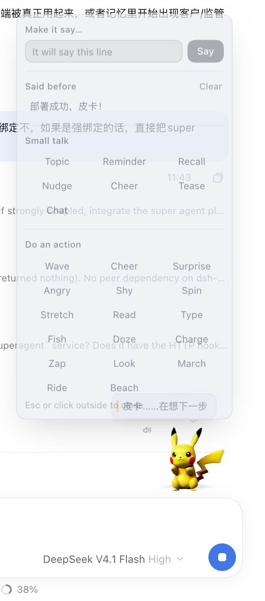
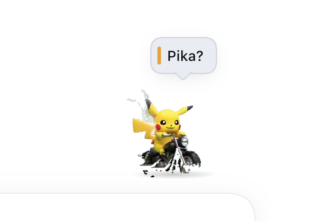

# Chatbox Pet

**A companion that lives beside the composer in DeepSeek Harness.** It stays
quiet while you work, moves and speaks when the agent's work state changes,
answers when you call it by name, and turns a pile of queued follow-ups into
one coherent request. Prompt Boost ships in the same bundle as a second,
independently switchable feature.

[Watch the demo](https://github.com/colsonSung/dsh-chatbox-pet/releases/download/v0.2.1/chatbox-pet-promo.mp4) ·
[Latest release](https://github.com/colsonSung/dsh-chatbox-pet/releases/tag/v0.2.1) ·
[中文技术文档](plugin/README.md)

[](https://github.com/colsonSung/dsh-chatbox-pet/releases/download/v0.2.1/chatbox-pet-promo.mp4)

> The character in the demo is **local demonstration artwork only**. No
> character or animation assets are bundled or licensed by this project.
> Bring or generate your own animation pack. See [Asset rights](#asset-rights).

## Install

You need a DeepSeek Harness profile and your own animation pack.

```bash
git clone https://github.com/colsonSung/dsh-chatbox-pet.git
cd dsh-chatbox-pet
./install.sh <profile>       # for example: ./install.sh desktop
```

The installer is idempotent: it adds the package to the profile and inserts the
bundle row into `<profile>/cordis.patch.yml`. **Restart the Harness
afterwards** — the host half loads at start-up.

Manual equivalent:

```bash
dsh plugin --profile <profile> add ./plugin
```

```yaml
# <profile>/cordis.patch.yml
- insert:
    - id: chatbox-pet
      name: 'dsh-chatbox-pet'
```

Then open a session and look at the composer's top-right corner. Type a wake
word to talk to the pet, or right-click it for the menu.

## Three independent switches

Settings → General → **Composer companion**:



| Switch | Off means |
| --- | --- |
| **Show pet** | Pikachu is gone: the dock, its bubbles, conversation mode and small talk with it. Everything else keeps working. |
| **Prompt boost** | The sparkle button and its panel are gone. The pet is unaffected. |
| **Sound** | Silent. The pet and boost still work. |

The first switch is named for what it does rather than after the character, so
"get this out of my way" does not read as "turn off a feature". Flipping it
writes only `pet` to the prefs file; the other two switches keep their state.

## What you get

| | |
| --- | --- |
| **A work-state companion** | Each state transition gets its own clip, sound and one-line bubble. Repeated polls of the same state stay quiet. |
| **Conversation, without sending** | Type `hi pika`, `pika pika`, `皮卡丘`, `电老鼠` or `pika` in the draft. It looks up at once and answers after a typing pause — **no message is sent**. |
| **Prompt Boost** | A sparkle turns a rough draft into an executable prompt, using your configured model and optional personal context. Auto-applies, undoes, and never sends on your behalf. |
| **Queue merge** | While the agent is busy, one chip folds 2–8 queued text messages into a single coherent request. The result stays queued. |
| **Small talk from your own notes** | Seven tones quoting your memory, meeting minutes, reading shelf or moments, with the source named. Local templates, no model call. |
| **Direct manipulation** | Right-click to make it say an exact line, replay a line it remembers, or play one of 17 actions. |
| **Video reading** | A host tool — `video_read` — turns a video file or a link into a timestamped transcript with speaker labels, OCR'd on-screen subtitles and keyframes. Local only; see [Video reading](#video-reading). |
| **Quick actions** | A glass "More" pill **inside** the composer's top-right corner opens a panel of shortcuts (transcribe, image, writing, video, read video, music, slides). A shortcut only fills the draft — it never sends. See [Quick actions](#quick-actions). |
| **Translation** | Inside the "More" panel: type, speak or drop a PDF/DOCX/TXT/MD/HTML, get a translation from your own model, and keep words and sentences in a favourite book with search and Markdown export. See [Translation](#translation). |

## Using it

### The agent's work has a visible rhythm

| State | Clip | Sound |
| --- | --- | --- |
| Thinking | Typing | A soft high note |
| Working | Reading | A mechanical double-tap |
| A step finished | Spin | A bright bell pair |
| Waiting for you | Shy | Two low pulses |
| Completed | Thunderbolt | A rising arpeggio |
| Stopped / interrupted | Shy | A soft descending pair |
| Failed | Angry | A low detuned growl |

The Harness records every ending as `turn/end`; the plugin reads
`data.reason.kind`, so a stopped task is never announced as a success. If the
reason cannot be read it stays unknown rather than assumed completed.

### Call it by name

The wake word is read from the composer's own draft state. The pet reacts
instantly, then answers once you stop typing for about 700 ms, in the language
you used. Conversation mode returns to idle after 15 seconds of quiet or when
the draft is cleared. The lines are a local, deterministic pool: no model
latency, no model cost.

### Turn a rough draft into an executable prompt

Click the sparkle beside the composer. Prompt Boost gathers optional context
from your memory, meeting minutes, reading shelf and moments, asks your
configured model for a better prompt, and applies it in place. You review the
rewrite and can undo it. The draft is **not** sent as a user message; if no
model is available the feature says so instead of pretending it rewrote
anything.

### Merge queued follow-ups

While the agent is busy, several short messages are often one request typed in
a hurry. The merge chip appears only when there are 2–8 text-only messages to
fold. The first queued item is edited to the merged text and the rest are
removed through the Host's own `session.updateQueue` path — the queue is not
bypassed.

- The model only reorganises what you already wrote; it must not invent a
  requirement.
- If the model is unavailable, the originals are joined and marked
  **not optimised**.
- If the queue changes while the answer is prepared, nothing is edited.
- If the agent claims an item mid-merge, the partial result is reported.
- Attachments refuse the merge, because a text-only edit cannot preserve them.

### Ask for small talk

The menu's small-talk section picks a real item from your stores and quotes its
heading or title, not an arbitrary fragment. It prefers the store that matches
the tone — reminders lean on meeting minutes, recollections lean on memory —
and tags the bubble with its source. An empty store falls back to an honest
generic line.

### Say exactly what you want, or play exactly one action



Right-click the pet, or focus it and press Shift+F10. The menu lets you type a
line and make the pet say it, replay a line it said before, choose a small-talk
tone, or play one of 17 actions.



## Video reading

The same bundle registers a host tool, **`video_read`**. Hand the model a video
file (drag it into the composer — the Harness gives the model a read-only path)
or a link, and it gets back:

| | |
| --- | --- |
| `media` | duration, resolution, fps, codecs, size |
| `transcript` | timestamped segments with `speaker` labels, plus a full timestamped text |
| `diarization` | how many people were detected (0/1 = one speaker or no speech) |
| `subtitles` | on-screen text read off the bottom of the frame, de-duplicated into timed lines |
| `frames` | keyframe PNGs the model can open with its image tool |

Everything runs locally: faster-whisper for transcription, sherpa-onnx for
speaker diarization, macOS Vision for OCR, yt-dlp for fetching links. No audio,
frame or transcript leaves the machine. WeChat Channels links are refused with
an explanation and a workaround instead of being faked.

Dependencies are optional and degrade one at a time: without `faster-whisper`
you still get metadata and keyframes; without `sherpa-onnx` the transcript just
has no speaker labels; without Vision (non-macOS) there are no subtitle lines.
Each gap is reported in `warnings`.

## Quick actions

A glass **More** pill sits **inside** the composer's top-right corner (the editor's
right padding is widened so the pill never covers typed text). It opens a glass
panel of shortcuts:

| | |
| --- | --- |
| 录音转写 / Transcribe | **works**: record or pick a file → local transcription → composer |
| 帮我写作 / Writing | **works**: genre + topic → the Host model writes a draft → composer |
| PPT 生成 / Slides | **works**: topic + audience → model outline → .pptx rendered here → download |
| 视频理解 / Read video | fills a ready-to-run `video_read` instruction for a link |
| 图像生成 / Image | fills a prompt (needs an image model this machine does not have) |
| 视频生成 / Video | fills a prompt (needs an external video service) |
| 音乐生成 / Music | fills a prompt (needs a music model) |

The first four open a **workbench** and really do the work:

- **Transcribe** records from the microphone or takes an audio/video file, runs
  faster-whisper on this machine (ffmpeg for the conversion) and shows the
  transcript with timestamps;
- **Writing** asks the Host's configured model for a draft in one of four
  genres;
- **Slides** has the model write an outline and renders it with python-pptx into
  a 16:9 editable .pptx, saved to `~/.dsh/chatbox-pet/decks/` (the newest 40 are
  kept) and downloadable from the panel;
- **Read video** prepares a `video_read` instruction for a pasted link.

Nothing is sent for you: every result lands in the composer (or on disk) and you
press send yourself. The last three shortcuts only fill a prompt — they need a
model or a service this machine does not have, and saying so is better than
faking it. The catalogue is data: adding a shortcut is one object in
`src/client/quick-actions.js`.

## Translation

The "More" panel gets a **Translate** entry: type text, record your voice, or
drop a document, and a translation comes back in the panel — no third-party MT
vendor, no extra key; it uses the model you already configured.

| Input | What happens |
| --- | --- |
| Text | Translate with ⌘/Ctrl+Enter; eight target languages, source on auto-detect — a single word returns a **dictionary card** (phonetic, senses, examples, usage note) |
| Voice | Record → transcribed on this machine → the text lands in the input |
| File | PDF / DOCX / TXT / Markdown / HTML parsed locally, then translated as one document (30 MB / 60k chars cap) |

Engines, in order: your **local translation model** (LM Studio or any
OpenAI-compatible endpoint — `hy-mt2-7b` on `127.0.0.1:6121` by default, about
0.5 s per sentence), then the Host model when the local server is not running.
Configured under `translate.local` in the patch (`enabled`, `baseUrl`, `model`).

The **Saved** view is the favourite book: every translation can be saved as a
word or a sentence, filtered, searched, deleted and exported as Markdown. It lives
in `~/.dsh/chatbox-pet/favorites.json`, so it survives a browser reset.

## Asset rights

**The repository and its releases ship no character or animation assets.**

Pikachu appears only as local demonstration artwork. It is not bundled, not
licensed by this project, and not offered as an asset pack. No affiliation or
endorsement is implied.

You must generate or provide your own character and animation assets, and you
are responsible for having the rights to use them. Do not redistribute the
demo's character pack in your own product. **MIT covers this plugin's code
only**, not characters, artwork, fonts or music.

The plugin reads a local pack from `~/.dsh/dsh-pet/pet/`:

```text
pokemon-animation/<action>.webm        # VP9-alpha, Chromium / Firefox
pokemon-animation/mov/<action>.mov     # HEVC-alpha, WebKit
pokemon-avatar.png                     # static fallback
```

The filename is the animation name. See
[THIRD_PARTY_NOTICES.md](THIRD_PARTY_NOTICES.md) for the full notice.

## Data and privacy

- The pet, its state polling, preferences and remembered lines are local.
- Conversation mode reads the draft without sending it, creating a session or
  making a request.
- Small talk uses local templates over local store collectors; it does not call
  a model for wording.
- Prompt Boost and queue merge call the model **only after you click**, through
  the Host's configured provider. They do not send a user message or start an
  agent turn.
- State polling pauses when the tab is hidden. Assets revalidate with a content
  ETag instead of being cached forever, because packs are regenerated in place.

**About the screenshots in this README:** they were captured in a throwaway
Harness profile (`DSH_HOME` and workspace under `/tmp`, synthetic session,
one plugin installed), not in the author's working profile — no real sessions,
workspace names, notes or account details are visible in them.

## Development

```bash
cd plugin
npm install                 # development and test dependencies only
node build.mjs              # rebuild client.js from src/client/**
node --test test/*.test.mjs # 166 unit tests
node tools/smoke.mjs        # route registration and handler behaviour
```

The committed `client.js` means installing the plugin needs no build step.
React stays external in the browser bundle; esbuild resolves from the plugin's
own dependencies, with a workspace fallback for development.

Verified for v0.2.1: **166 unit tests**, route smoke, and **nine live browser
suites / 124 checks**, including a real two-message queue merge. The settings
row was additionally verified in a running app: switching **Show pet** off
removes the pet, keeps the prompt-boost trigger and the sound switch working,
and writes only `pet` to the prefs file.

## Repository layout

```text
install.sh                 idempotent profile installer
docs/                      screenshots used by this README
plugin/
  index.js                 Host entry
  client.js                committed browser bundle
  src/host/                routes, state, memory, merge and prompt boost
  src/client/              composer seats, pet, menu, sounds and stores
  test/                    unit and component tests
  tools/                   smoke and development tools
  README.md                中文技术文档与接口契约
```

## Current limits

- No character pack is included; you supply the artwork.
- Queue merge accepts 2–8 text-only messages. Attachments are not folded.
- Small talk is intentionally local and templated, not free-form model chat.
- The pet exists where the session composer exists; it is not a separate
  desktop window.
- Browser autoplay policy applies: sound unlocks after the first user gesture.

## License

MIT, Ethan Song. See [LICENSE](LICENSE).

DeepSeek Harness, third-party libraries and any character artwork belong to
their respective owners.
