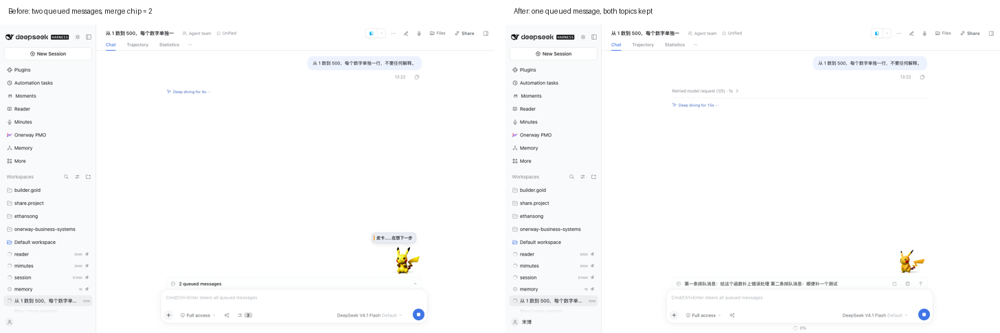
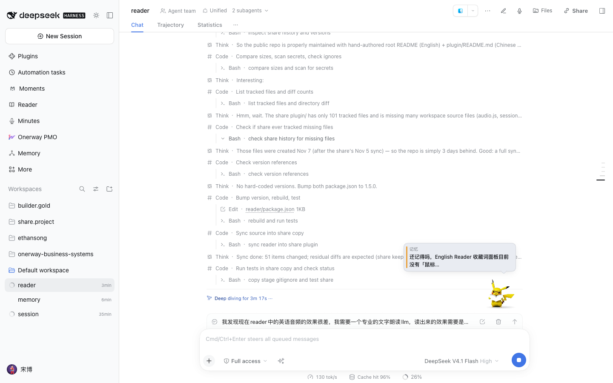

# Chatbox Pet for DeepSeek Harness

A small companion lives at the top-right corner of the composer. It is idle
most of the time — it plays a loop and leaves you alone — and it moves only
when something happens: the agent starts thinking, a tool runs, a step
finishes, a task succeeds, fails, or gets stopped.

Then it does more than animate. Call it by name and it talks back. Right-click
it and it will say a line you give it, run one specific animation, or bring up
something you wrote down days ago.


> 中文说明：一个挂在输入框右上角的皮卡丘。大部分时间安静地待着，只在 agent
> 的工作状态变化时动一下；喊它的名字会跟你对话；右键可以让它说指定的话、做指定的
> 动作，或者从你的记忆/纪要/读书/随手记里挑一件事说给你听。完整的中文技术文档见
> [`plugin/README.md`](plugin/README.md)。

## What you get

| | |
| --- | --- |
| **Work state, not a screensaver** | six states — thinking, working, step finished, waiting on you, success, error — each with its own clip, its own sound, and one line in a bubble. It speaks only on *transitions*, and repeated polls of the same state change nothing |
| **Three different endings, three different reactions** | a **finished** task plays the rising arpeggio, a **stopped** one a soft descending pair with a sheepish clip, a **failed** one a low growl with an angry clip. The Harness records all three as the same `turn/end` event, so the outcome is read from `reason.kind` — a stopped task never sounds like a success |
| **Call it by name** | type `hi pika`, `pika pika`, `皮卡丘`, `电老鼠` or `pika` in the composer — **without sending anything**. It looks up immediately, then answers the content once you pause. `你笨死了` gets the angry clip, `我困了` gets a doze, `皮卡丘你真厉害` gets a cheer |
| **Make it say anything** | right-click → type a line → it waves and says exactly that. The pet keeps the last 24 lines, so the same line is one click away after a reload, tomorrow, in another session |
| **Make it do anything** | right-click → 17 one-click actions: wave, cheer, surprise, angry, shy, spin, stretch, read, type, fish, doze, charge, zap, look, march, ride, beach |
| **It brings things up** | the "small talk" section picks a real thing out of your own stores — memory, meeting minutes, reading shelf, moments — and says it as a topic, a reminder, a recollection, a nudge, encouragement, a tease or chit-chat, with a tag saying which store it came from |
| **Sound that means something** | every state has its own timbre, chosen by the line so the same line always sounds the same; a speaker button mutes it. Web Audio, no asset files |
| **Two features, one switch each** | the pet and the prompt booster are independent toggles in Settings → Composer companion |

## Merge the queue

While the agent is busy, the messages you send wait in a queue. Two or three
follow-ups are usually one request — so a chip appears beside the sparkle
whenever two or more are waiting, and folds them into one:



The merged message is **still queued**, not sent behind your back. The first
item is edited through the Host's own queue command and the rest are removed,
so the agent picks up one coherent request instead of running three turns.

The Host reorganises only what you already wrote. If the model is unavailable,
it simply joins the originals — **your words are never lost because the model
was down**. If the queue changes while the merge is being prepared, nothing is
edited and the chip asks you to try again.

## The small talk

It reads what you wrote and says it back, tagged with where it came from.



A line is **local templates, not a model call**: a companion that takes twenty
seconds to answer is a bug, not a companion. The Host picks a real item, takes
its heading or title as the quote (never the first twenty characters of a body
— a truncated date says nothing), and the page renders one of several
phrasings. Every grounded line shows its quote; the phrasings that could not
are filtered out at render time.

## The menu

Right-click the pet, or focus it and press Shift+F10.


The 17 actions are the animation pack's own clips, played once and back to the
idle loop — including two ambient ones, a motorcycle ride and a beach holiday:


## Install

```bash
git clone https://github.com/colsonSung/dsh-chatbox-pet.git
cd dsh-chatbox-pet
./install.sh desktop        # your profile name
```

`install.sh` takes an optional profile name and is idempotent. It installs the
package into the profile and adds the bundle row to
`<profile>/cordis.patch.yml`. **Restart the Harness afterwards** — the host
half of a plugin is loaded at start-up.

Manual equivalent:

```bash
dsh plugin --profile desktop add ./plugin
```

```yaml
# <profile>/cordis.patch.yml
- insert:
    - id: chatbox-pet
      name: 'dsh-chatbox-pet'
```

## Bring your own animation pack

The plugin ships **no artwork and no character assets**. The Pikachu shown in
the screenshots and video is a **local demonstration only**: it is not bundled,
not licensed by this project, and not offered for redistribution.

You must generate or provide your own character and animation assets. Do not
reuse the demo's character pack in a distributed product. **MIT covers the
plugin's code only**, not any character, artwork, font or music.

The plugin reads a local pack from `~/.dsh/dsh-pet/pet/`:

- `pokemon-animation/<action>.webm` — VP9-alpha, for Chromium/Firefox;
- `pokemon-animation/mov/<action>.mov` — HEVC-alpha, for WebKit;
- `pokemon-avatar.png` — the static fallback.

The filenames are the animation names. The animation pack is a local asset
boundary, not a download bundled with this repository. See
[`THIRD_PARTY_NOTICES.md`](THIRD_PARTY_NOTICES.md).

## How it talks to the Harness

Everything runs in the page or in the Host; nothing leaves your machine, and
no message is ever sent on your behalf.

- The pet renders from the `conversation.input.dock` slot of the session's own
  composer, so it exists exactly where a session does.
- State polling hits `GET /api/chatbox-pet/state?session=<id>` every six
  seconds while the tab is visible, and stops when it is hidden.
- Conversation mode reads the composer's draft through the conversation
  plugin's own `useInput` selector. The wake word never sends, never creates a
  session, and never makes a request.
- Small talk reuses the prompt booster's four store collectors, each behind its
  own timeout, so a dead store costs nothing and never throws.
- Assets answer `cache-control: no-cache` + a content `ETag`, because the clips
  are regenerated in place by the animation pipeline: a long-lived cache would
  keep playing the old clip after a rebuild.

The exact contract — statuses, routes, payloads, test hooks, the intent table,
the memory file — is in [`plugin/README.md`](plugin/README.md).

## Development

```bash
cd plugin
node build.mjs          # rebuild client.js from src/client/**
node --test test/*.test.mjs
node tools/smoke.mjs    # route registration and handler behaviour
```

The client bundle is built by esbuild; `client.js` is committed so an install
needs no build step.

## License

MIT, Ethan Song. See [LICENSE](LICENSE).

The DeepSeek Harness, and the character artwork in the animation pack, belong
to their own owners.
